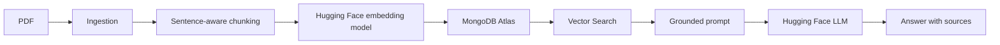
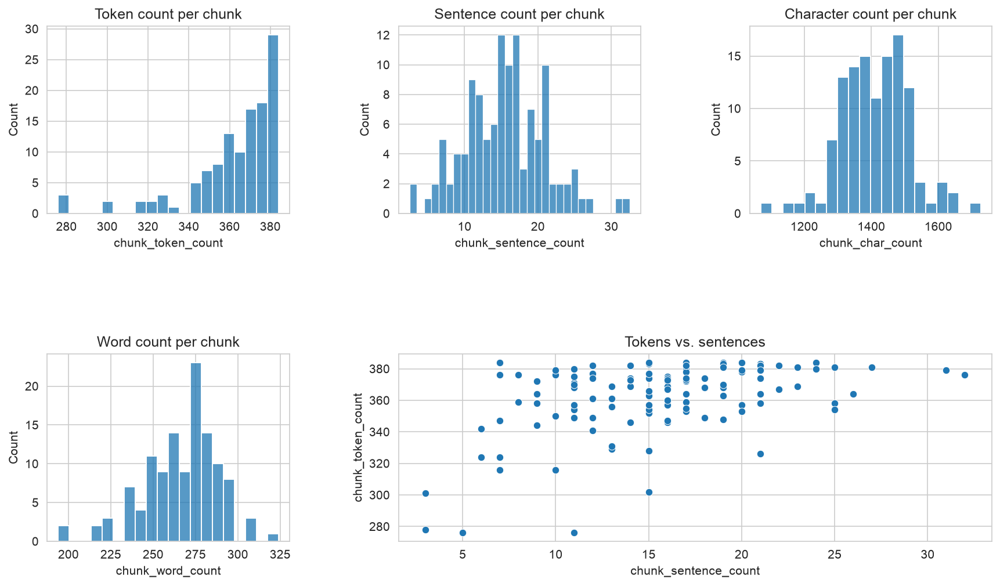

# MongoDB RAG System

A modular Retrieval-Augmented Generation (RAG) system for asking grounded questions about PDF documents. The project uses Hugging Face models for embeddings and generation, MongoDB Atlas Vector Search for retrieval, and a sentence-aware, token-aware ingestion pipeline.

## Highlights

- PDF ingestion with chapter and outline metadata.
- Sentence-aware chunking with configurable overlap.
- Automatic chunk-size alignment with the selected embedding model.
- Manual chunk-size overrides with an explicit confirmation step.
- Batched, normalized embeddings with validation before persistence.
- MongoDB Atlas Vector Search and exact cosine-similarity search.
- Grounded prompts with chunk citations and abstention behavior.
- Interactive setup and query loop for local use.
- Separate CLI commands for indexing and asking questions.
- Unit tests for chunking, model limits, embedding integrity, and retrieval results.

## Architecture



The embedding model controls the input budget used by chunking. The generation model is independent and can be changed without re-indexing, while changing the embedding model requires re-indexing the documents.

## Intended use: internal knowledge retrieval

This project is designed to support internal knowledge activities by making
information contained in company documents easier to find and use. Typical
source material includes:

- technical manuals and product specifications;
- written routines, standard operating procedures, and work instructions;
- troubleshooting guides and internal technical documentation;
- policies, onboarding material, and operational references.

Employees can ask a question in natural language and retrieve relevant parts
of the indexed documents, together with source chunks that support the answer.
For example, the system can help locate a specific technical requirement in a
manual, identify the steps of a written routine, or find an internal rule
needed to complete an operational task.

The repository currently provides a modular Python reference implementation
with PDF ingestion, MongoDB Atlas Vector Search, Hugging Face models, a CLI,
and an interactive query loop. It should be treated as a foundation for an
internal knowledge assistant: a production deployment would additionally need
authentication, document-level permissions, audit logging, document lifecycle
management, and systematic evaluation of retrieval and answer quality.

Answers should be checked against the cited source material. Document curation
is also important because PDFs may contain appendices, legal notices, or other
boilerplate that can be retrieved for broad questions.

## Requirements

- Python 3.10 or newer.
- A MongoDB Atlas cluster with Vector Search enabled.
- Network access from the runtime to the Atlas cluster.
- Hugging Face model access. Public models do not normally require a token.
- Enough local memory for the selected embedding and generation models.

## MongoDB Atlas setup

Before starting the application, create a MongoDB Atlas deployment. MongoDB
Atlas is the remote database service used by this project; a local MongoDB
installation is not required.

Complete these steps in the Atlas console:

1. Create an Atlas account and a project.
2. Create a cluster. The free M0 tier is sufficient for development and
   testing.
3. Create a database user under **Security > Database Access**. Use this
   username and password in the MongoDB connection URI.
4. Add the IP address of the machine running the application under
   **Security > Network Access**. Avoid allowing access from every IP unless
   that is intentional and properly secured.
5. In **Browse Collections**, create the database `rag_system` and the
   collection `document_chunks`, or use different names and provide them when
   the application asks for the database and collection settings.

The application creates the MongoDB Atlas vector-search index when it does not
exist and reuses an existing index with the configured name. The vector index
is separate from the database and collection: it is used to search the stored
embedding vectors efficiently.

## Installation

```bash
conda create -n rag-system python=3.11
conda activate rag-system
pip install -r requirements.txt
pip install -r requirements-dev.txt
```

The first model execution downloads model files from Hugging Face. Model size and download time depend on the selected models.

## Configuration

The interactive workflow asks for MongoDB credentials and model names at runtime. MongoDB Atlas connectivity is tested immediately after the credentials are entered, before the application asks for database, model, PDF, or chunking settings. Invalid credentials can therefore be corrected without downloading models.

If you enter a full URI, it must include the URI scheme and the cluster host:

```bash
export MONGODB_URI="mongodb+srv://<username>:<password>@<cluster-host>/"
export MONGODB_DATABASE="rag_system"
export MONGODB_COLLECTION="document_chunks"
export MONGODB_VECTOR_INDEX="vector_index"
export EMBEDDING_MODEL="sentence-transformers/all-MiniLM-L6-v2"
export LLM_MODEL="Qwen/Qwen2.5-1.5B-Instruct"
```

Do not enter credentials in a slash-separated form such as `username/password/cluster`. If the password contains URI-special characters, use the separate-variable configuration below or URL-encode the password.

Alternatively, configure MongoDB with separate variables:

```bash
export MONGODB_USERNAME="<username>"
export MONGODB_PASSWORD="<password>"
export MONGODB_CLUSTER_HOST="<cluster-host>"
```

### Load MongoDB credentials from JSON

You can store the MongoDB connection settings in a local JSON file. Start the
interactive application and type `load` when it asks for the MongoDB URI:

```text
MongoDB URI (or type 'load' for a JSON credentials file): load
Credentials JSON path (press Enter to use 'config/mongodb_credentials.json'):
```

Use [config/mongodb_credentials.example.json](config/mongodb_credentials.example.json) as a template. The JSON file may contain either a complete `mongodb_uri` or the separate fields `username`, `password`, and `cluster_host`. The database, collection, and vector-index names are optional and default to `rag_system`, `document_chunks`, and `vector_index`.

Copy the example file to `config/mongodb_credentials.json`, replace the
placeholder values, and never commit the real credentials file. It is excluded
by `.gitignore`.

Never commit `.env`, credentials, access tokens, or private documents.

## Interactive workflow

The interactive mode performs the following sequence:

1. Requests a MongoDB URI, separate credentials, or `load` for a JSON credentials file.
2. Tests the MongoDB Atlas connection immediately.
3. Requests database, collection, vector-index, embedding-model, and LLM settings.
4. Requests the PDF path and chunking options.
5. Asks whether an incompatible existing vector index may be recreated.
6. Loads the embedding model and derives its tokenizer limit.
7. Indexes the PDF, generates validated embeddings, and creates or reuses the vector index.
8. Runs preflight checks and waits for Atlas to return real vector results.
9. Optionally displays database statistics, plots, and preflight results.
10. Starts the query loop.

Prompts with a default explicitly say `press Enter to use '<value>'`. An empty manual chunk-size input selects the model-derived token limit.

```bash
python RAG_System.py
```

You can also start it explicitly:

```bash
python RAG_System.py interactive
```

The preflight checks cover:

1. MongoDB Atlas connectivity.
2. Embedding dimensionality and normalization.
3. Presence of stored embeddings.
4. Vector search availability.
5. LLM loading and generation.

After the preflight checks, the application asks:

```text
Display database plots and preflight test results before queries? (press Enter to use 'y'):
```

The default display includes a chunk table, descriptive statistics, a preflight-status table, and plots for token count, sentence count, character count, word count, and tokens versus sentences. The plot is automatically saved as `reports/database_diagnostics.png`. Close the plot window to continue to the query loop.

### Diagnostic plot preview



Type `exit`, `quit`, or `q` in the query prompt to stop the application.

## Command-line usage

### Index a PDF

```bash
python RAG_System.py index \
  --pdf data/alice_in_wonderland.pdf \
  --embedding-model sentence-transformers/all-MiniLM-L6-v2 \
  --replace
```

When `--chunk-size` is omitted, the effective maximum sequence length of the embedding model is used automatically.

To request a manual token budget:

```bash
python RAG_System.py index \
  --pdf data/alice_in_wonderland.pdf \
  --embedding-model sentence-transformers/all-mpnet-base-v2 \
  --chunk-size 256 \
  --replace
```

If the manual value differs from the model limit, the command asks for confirmation. Add `--yes` only when that override is intentional.

If an index with the selected name already exists, its definition is compared with the current embedding path, dimension, similarity, and filter fields. A compatible index is reused. An incompatible index stops the command unless you explicitly pass:

```bash
--recreate-index
```

This makes index reuse deterministic and prevents an old index configuration from being silently applied to a new embedding model.

### Ask a question

```bash
python RAG_System.py ask \
  "Who is Alice?" \
  --embedding-model sentence-transformers/all-MiniLM-L6-v2 \
  --llm-model Qwen/Qwen2.5-1.5B-Instruct
```

The embedding model used for questions must be the same model used to index the stored chunks. The LLM can be changed independently.

For the educational exact-search path from the notebook:

```bash
python RAG_System.py ask "Who is Alice?" --exact
```

## Model-aware chunking

The selected embedding model is loaded once and provides both its tokenizer and effective maximum sequence length. The chunker uses that tokenizer to ensure each chunk remains within the configured token budget.

The system also validates:

- vector dimensionality;
- numeric and finite values;
- non-zero vector norm;
- normalized embeddings;
- model metadata;
- query/document compatibility.

Changing the embedding model requires re-indexing all affected documents and recreating the vector index when the dimensionality changes.

## Testing

Run the unit tests from the project root:

```bash
python -m pytest tests/ -v
```

The chunking tests also provide a diagnostic table and plotting helper. To display the report directly:

```bash
PYTHONPATH=. python tests/test_chunking.py
```

The interactive database diagnostics require `pandas`, `seaborn`, and `matplotlib`, which are included in `requirements.txt`.

To perform a syntax-only validation:

```bash
python -m py_compile RAG_System.py src/*.py scripts/*.py tests/*.py
```

## Project structure

```text
RAG_System/
├── RAG_System.py              # Main CLI entry point
├── README.md
├── .env.example
├── requirements.txt
├── requirements-dev.txt
├── data/                       # Local documents; keep private files out of Git
├── scripts/
│   ├── interactive.py          # Setup, preflight, and query loop
│   ├── index_document.py       # PDF indexing command
│   └── ask_question.py         # Single-question command
├── src/
│   ├── ingestion.py            # PDF extraction and normalization
│   ├── chunking.py             # Sentence/token-aware chunking
│   ├── model_limits.py         # Model limit discovery and confirmation
│   ├── embeddings.py           # Embedding generation and validation
│   ├── diagnostics.py          # Database statistics and preflight plots
│   ├── vector_store.py         # MongoDB persistence and vector search
│   ├── retrieval.py             # Query embedding and retrieval validation
│   ├── generation.py           # Prompting and LLM generation
│   └── rag_pipeline.py         # End-to-end RAG orchestration
└── tests/
    ├── test_chunking.py
    └── test_retrieval.py
```

## Operational considerations

- Keep MongoDB credentials outside source code and version control.
- Restrict MongoDB Atlas Network Access to trusted sources where possible.
- Use a stable `document_id` when re-indexing a document.
- Keep the embedding model and its vector index configuration together.
- Add an application-level score threshold before production deployment.
- Evaluate retrieval recall and answer grounding on representative internal documents before relying on generated answers.
- Do not commit confidential PDFs or generated model caches.

## Troubleshooting

### MongoDB connection fails

Check the URI, credentials, cluster host, and Atlas Network Access rules. A full URI must start with `mongodb://` or `mongodb+srv://`. Do not leave placeholders such as `<password>` in the URI. The interactive application performs a `ping` immediately after credential entry.

### Diagnostics cannot be displayed

Install the project dependencies:

```bash
pip install -r requirements.txt
```

The query loop can still continue when the optional diagnostics libraries are unavailable.

### The model cannot be loaded

Check the model id on Hugging Face, install the required dependencies, and verify local memory. Private or gated models may require `HF_TOKEN`.

### Results are irrelevant

Inspect the retrieved chunks and scores first. Then verify that the same embedding model was used for indexing and querying, and evaluate chunk size, overlap, and the retrieval `top_k` value.

## License

Add the project license before publishing a public release.
